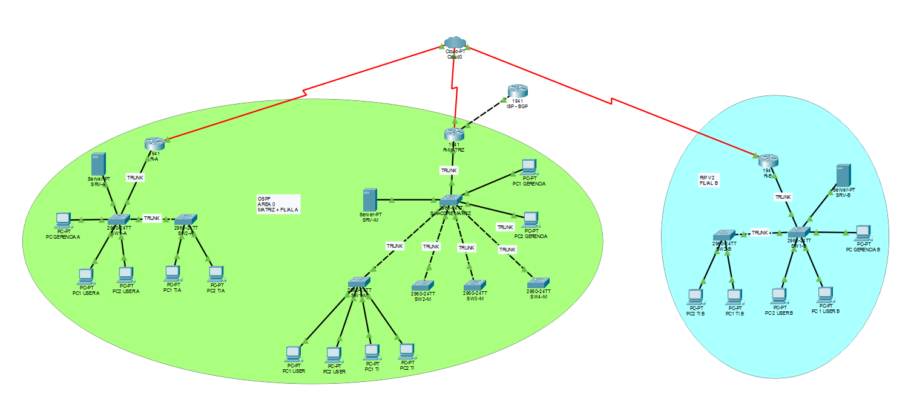
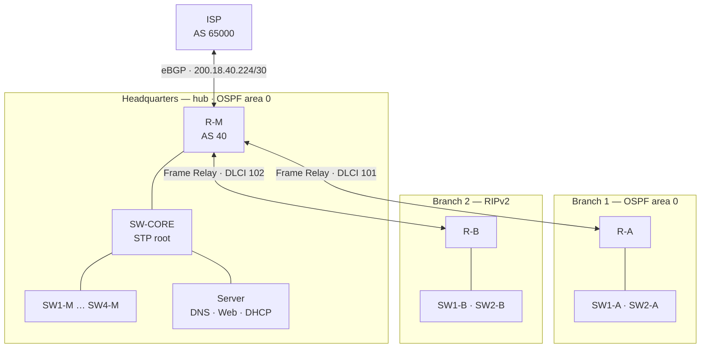

# Network Design with Dynamic Routing

[🇧🇷 Português](README.md) | 🇺🇸 English

A **multi-site** enterprise network built in Cisco Packet Tracer for the fictional company **TechEdu Solutions**: a headquarters and two branches in a **hub-and-spoke** topology, with **VLSM**, **VLANs**, **PVST+**, **Frame Relay**, **OSPF + RIPv2 with mutual redistribution**, **BGP** with the ISP, and **DHCP, DNS and Web** services.

> Group coursework for **Internetworking** (Interconexão de Redes) — Associate Degree (CST) in Computer Networks, Federal University of Santa Maria (UFSM), Colégio Técnico Industrial de Santa Maria. Prof. Dr. Walter P. Filho. November 2025.



## Topology



- **Hub-and-spoke WAN:** headquarters is the hub; the branches connect to it through point-to-point Frame Relay PVCs.
- **Hierarchical star LAN:** at each site, access switches connect to a central switch, with no daisy-chaining.
- **Inter-VLAN routing:** router-on-a-stick, with one 802.1Q sub-interface per VLAN on each router.

## IPv4 addressing with VLSM

Block `200.18.40.0/24`, allocated from the largest to the smallest host requirement.

| # | Segment | Hosts needed | Hosts avail. | Network | Mask | Broadcast |
|---|---|---|---|---|---|---|
| 1 | HQ VLAN 10 (Users) | 58 | 62 | 200.18.40.0 | /26 | 200.18.40.63 |
| 2 | Branch 1 VLAN 10 | 26 | 30 | 200.18.40.64 | /27 | 200.18.40.95 |
| 3 | Branch 2 VLAN 10 | 26 | 30 | 200.18.40.96 | /27 | 200.18.40.127 |
| 4 | HQ VLAN 20 (IT) | 22 | 30 | 200.18.40.128 | /27 | 200.18.40.159 |
| 5 | HQ VLAN 30 (Services) | 12 | 14 | 200.18.40.160 | /28 | 200.18.40.175 |
| 6 | HQ VLAN 99 (Management) | 6 | 6 | 200.18.40.176 | /29 | 200.18.40.183 |
| 7 | Branch 1 VLAN 20 | 6 | 6 | 200.18.40.184 | /29 | 200.18.40.191 |
| 8 | Branch 2 VLAN 20 | 6 | 6 | 200.18.40.192 | /29 | 200.18.40.199 |
| 9 | Branch 2 VLAN 99 | 5 | 6 | 200.18.40.200 | /29 | 200.18.40.207 |
| 10 | Branch 1 VLAN 99 | 4 | 6 | 200.18.40.208 | /29 | 200.18.40.215 |
| 11 | WAN HQ ↔ Branch 1 | 2 | 2 | 200.18.40.216 | /30 | 200.18.40.219 |
| 12 | WAN HQ ↔ Branch 2 | 2 | 2 | 200.18.40.220 | /30 | 200.18.40.223 |
| 13 | WAN HQ ↔ ISP | 2 | 2 | 200.18.40.224 | /30 | 200.18.40.227 |
| — | Free for growth | — | — | 200.18.40.228 – .255 | — | — |

The first usable address of each LAN subnet is the gateway (the site router's sub-interface).

## Protocols and configuration

| Layer / area | Implementation |
|---|---|
| VLANs | 10 Users, 20 IT, 30 Services (HQ only), 99 Management. 802.1Q trunks with **VLAN 99 as native**. |
| STP | **PVST+**. SW-CORE is root for every HQ VLAN (priority 0 on VLAN 99, 24576 on the others), SW1-M at 28672 as backup. `portfast` + `bpduguard` on access ports. |
| WAN | **Frame Relay** with point-to-point sub-interfaces: DLCI 101 (Branch 1) and 102 (Branch 2). |
| Interior routing | **OSPF area 0** at HQ and Branch 1. **RIPv2** with `no auto-summary` at Branch 2. **Mutual OSPF ↔ RIP redistribution** on R-M. |
| Edge | **eBGP** between AS 40 (TechEdu) and AS 65000 (ISP), advertising the `200.18.40.0/24` aggregate (static route to `Null0`). |
| Services | **DNS + Web** on the HQ VLAN 30 server (`200.18.40.174`, A record `web.techedu.local`). **DHCP** through `ip helper-address` on the routers, pointing to a server at each site. |
| Management | VLAN 99 SVI on every switch, with `ip default-gateway`. |

Per-protocol details with config excerpts are in [docs/en/configuration.md](docs/en/configuration.md).

## Validation

| Test | Result | Evidence |
|---|---|---|
| Ping from Branch 1 (OSPF) to an HQ PC | ✅ 4/4 replies | [screenshot](docs/img/08-ping-filial1-matriz.png) |
| `tracert web.techedu.local` from Branch 1 | ✅ R-A → R-M → server (3 hops) | [screenshot](docs/img/09-tracert-filial1-web.png) |
| DNS resolution of `web.techedu.local` | ✅ resolves to `200.18.40.174` | [screenshot](docs/img/07-dns-ping.png) |
| R-M routing table | ✅ `O` routes (Branch 1) and `R` routes (Branch 2) | [screenshot](docs/img/05-tabela-de-rotas.png) |
| `show ip protocols` on R-A and R-M | ✅ OSPF and RIP running, redistribution on R-M | [R-A](docs/img/10-ip-protocols-r-a.png) · [R-M](docs/img/11-ip-protocols-r-m.png) |
| `show ip bgp summary` on R-M | ✅ neighbor `200.18.40.226` (AS 65000) established | [screenshot](docs/img/12-bgp-summary-r-m.png) |
| `show frame-relay map` on R-M | ✅ DLCIs 101 and 102 active | [screenshot](docs/img/13-frame-relay-map.png) |

Details in [docs/en/validation.md](docs/en/validation.md).

## Hardening

- Consistent device naming (`R-M`, `R-A`, `SW-CORE`, `SW1-M`…) and interface `description`s.
- Restricted-access `banner motd` on every device.
- Per-site passwords for console, VTY and `enable secret`.
- `bpduguard` on access ports.

> Passwords and hashes were **removed** from the published configs (`<REMOVIDO>`). The `.pkt` file still contains the original lab passwords.

**Known limitations:** the configs use `no service password-encryption` (line passwords stored in cleartext on the device) and VTY access with a plain password, without SSH.

## Repository layout

```
dynamic-routing-protocols-network/
├── packet-tracer/
│   └── dynamic-routing-protocols-network.pkt # open in Cisco Packet Tracer 8.x
├── configs/                                   # running-config of each device
│   ├── ISP.txt  R-M.txt  R-A.txt  R-B.txt
│   └── SW-CORE.txt  SW1..4-M.txt  SW1..2-A.txt  SW1..2-B.txt
└── docs/
    ├── pt-br/   en/                           # documentation
    └── img/                                   # topology and test screenshots
```

---

**Author:** Victor de Menezes — [LinkedIn](https://www.linkedin.com/in/victordmnzs/)
