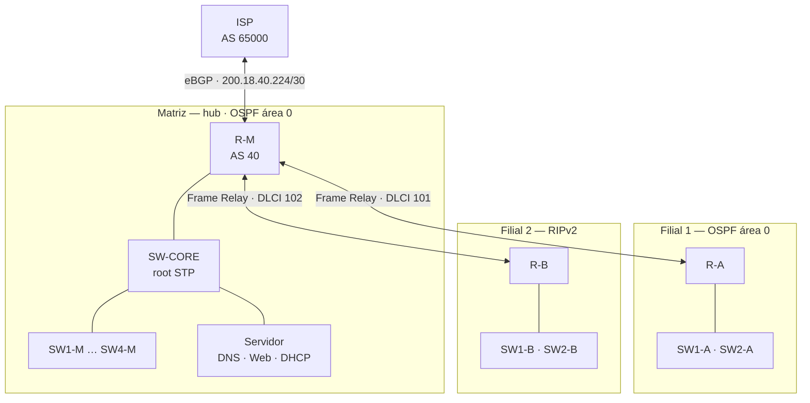

# Projeto de Rede com Roteamento Dinâmico

🇧🇷 Português | [🇺🇸 English](README.en.md)

Projeto de rede corporativa **multi-site** no Cisco Packet Tracer para a empresa fictícia **TechEdu Solutions**: uma Matriz e duas filiais em topologia **hub-and-spoke**, com **VLSM**, **VLANs**, **PVST+**, **Frame Relay**, **OSPF + RIPv2 com redistribuição mútua**, **BGP** com o provedor e serviços de **DHCP, DNS e Web**.

> Trabalho em grupo da disciplina de **Interconexão de Redes** — CST em Redes de Computadores, Universidade Federal de Santa Maria (UFSM), Colégio Técnico Industrial de Santa Maria. Prof. Dr. Walter P. Filho. Novembro de 2025.


## Topologia



- **WAN hub-and-spoke:** a Matriz é o hub e as filiais se ligam a ela por PVCs Frame Relay ponto a ponto.
- **LAN hierárquica em estrela:** em cada site os switches de acesso se ligam a um switch central, sem cascateamento.
- **Roteamento entre VLANs:** router-on-a-stick, com uma sub-interface 802.1Q por VLAN em cada roteador.

## Endereçamento IPv4 com VLSM

Bloco `200.18.40.0/24`, alocado da maior para a menor necessidade de hosts.

| # | Segmento | Hosts nec. | Hosts disp. | Rede | Máscara | Broadcast |
|---|---|---|---|---|---|---|
| 1 | Matriz VLAN 10 (Usuários) | 58 | 62 | 200.18.40.0 | /26 | 200.18.40.63 |
| 2 | Filial 1 VLAN 10 | 26 | 30 | 200.18.40.64 | /27 | 200.18.40.95 |
| 3 | Filial 2 VLAN 10 | 26 | 30 | 200.18.40.96 | /27 | 200.18.40.127 |
| 4 | Matriz VLAN 20 (TI) | 22 | 30 | 200.18.40.128 | /27 | 200.18.40.159 |
| 5 | Matriz VLAN 30 (Serviços) | 12 | 14 | 200.18.40.160 | /28 | 200.18.40.175 |
| 6 | Matriz VLAN 99 (Gerência) | 6 | 6 | 200.18.40.176 | /29 | 200.18.40.183 |
| 7 | Filial 1 VLAN 20 | 6 | 6 | 200.18.40.184 | /29 | 200.18.40.191 |
| 8 | Filial 2 VLAN 20 | 6 | 6 | 200.18.40.192 | /29 | 200.18.40.199 |
| 9 | Filial 2 VLAN 99 | 5 | 6 | 200.18.40.200 | /29 | 200.18.40.207 |
| 10 | Filial 1 VLAN 99 | 4 | 6 | 200.18.40.208 | /29 | 200.18.40.215 |
| 11 | WAN Matriz ↔ Filial 1 | 2 | 2 | 200.18.40.216 | /30 | 200.18.40.219 |
| 12 | WAN Matriz ↔ Filial 2 | 2 | 2 | 200.18.40.220 | /30 | 200.18.40.223 |
| 13 | WAN Matriz ↔ ISP | 2 | 2 | 200.18.40.224 | /30 | 200.18.40.227 |
| — | Livre para expansão | — | — | 200.18.40.228 – .255 | — | — |

O primeiro endereço útil de cada sub-rede de LAN é o gateway (sub-interface do roteador do site).

## Protocolos e configurações

| Camada / área | Implementação |
|---|---|
| VLANs | 10 Usuários, 20 TI, 30 Serviços (só na Matriz), 99 Gerência. Trunks 802.1Q com **VLAN 99 nativa**. |
| STP | **PVST+**. SW-CORE é root de todas as VLANs (prioridade 0 na VLAN 99 e 24576 nas demais), SW1-M com 28672 como backup. `portfast` + `bpduguard` nas portas de acesso. |
| WAN | **Frame Relay** com sub-interfaces point-to-point: DLCI 101 (Filial 1) e 102 (Filial 2). |
| Roteamento interno | **OSPF área 0** na Matriz e na Filial 1. **RIPv2** com `no auto-summary` na Filial 2. **Redistribuição mútua** OSPF ↔ RIP no R-M. |
| Borda | **eBGP** entre o AS 40 (TechEdu) e o AS 65000 (ISP), anunciando o agregado `200.18.40.0/24` (rota estática para `Null0`). |
| Serviços | **DNS + Web** no servidor da VLAN 30 da Matriz (`200.18.40.174`, registro A `web.techedu.local`). **DHCP** via `ip helper-address` nos roteadores, apontando para um servidor em cada site. |
| Gerência | SVI na VLAN 99 em cada switch, com `ip default-gateway`. |

O detalhamento por protocolo, com trechos das configs, está em [docs/pt-br/configuracao.md](docs/pt-br/configuracao.md).

## Validação

| Teste | Resultado | Evidência |
|---|---|---|
| Ping da Filial 1 (OSPF) para um PC da Matriz | ✅ 4/4 respostas | [print](docs/img/08-ping-filial1-matriz.png) |
| `tracert web.techedu.local` da Filial 1 | ✅ R-A → R-M → servidor (3 saltos) | [print](docs/img/09-tracert-filial1-web.png) |
| Resolução DNS de `web.techedu.local` | ✅ resolve para `200.18.40.174` | [print](docs/img/07-dns-ping.png) |
| Tabela de rotas do R-M | ✅ rotas `O` (Filial 1) e `R` (Filial 2) | [print](docs/img/05-tabela-de-rotas.png) |
| `show ip protocols` no R-A e no R-M | ✅ OSPF e RIP ativos, redistribuição no R-M | [R-A](docs/img/10-ip-protocols-r-a.png) · [R-M](docs/img/11-ip-protocols-r-m.png) |
| `show ip bgp summary` no R-M | ✅ vizinho `200.18.40.226` (AS 65000) estabelecido | [print](docs/img/12-bgp-summary-r-m.png) |
| `show frame-relay map` no R-M | ✅ DLCIs 101 e 102 ativos | [print](docs/img/13-frame-relay-map.png) |

Detalhes em [docs/pt-br/validacao.md](docs/pt-br/validacao.md).

## Hardening

- Nomenclatura padronizada dos equipamentos (`R-M`, `R-A`, `SW-CORE`, `SW1-M`…) e `description` nas interfaces.
- `banner motd` de acesso restrito em todos os equipamentos.
- Senhas separadas por site em console, VTY e `enable secret`.
- `bpduguard` nas portas de acesso.

> As senhas e os hashes foram **removidos** das configs publicadas (`<REMOVIDO>`). O arquivo `.pkt` ainda contém as senhas originais do laboratório.

**Limitações conhecidas:** as configs usam `no service password-encryption` (senhas de linha em texto claro no equipamento) e acesso VTY por senha simples, sem SSH.

## Estrutura do repositório

```
dynamic-routing-protocols-network/
├── packet-tracer/
│   └── dynamic-routing-protocols-network.pkt # abrir no Cisco Packet Tracer 8.x
├── configs/                                   # running-config de cada equipamento
│   ├── ISP.txt  R-M.txt  R-A.txt  R-B.txt
│   └── SW-CORE.txt  SW1..4-M.txt  SW1..2-A.txt  SW1..2-B.txt
└── docs/
    ├── pt-br/   en/                           # documentação
    └── img/                                   # topologia e prints dos testes
```

---

**Autor:** Victor de Menezes — [LinkedIn](https://www.linkedin.com/in/victordmnzs/)
