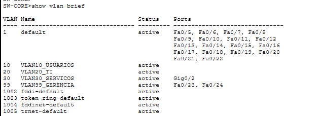
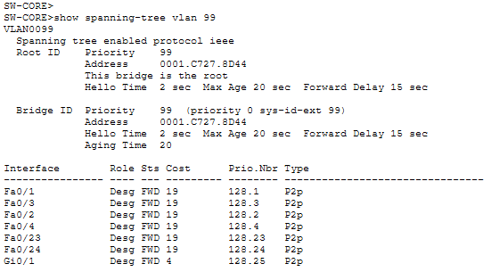
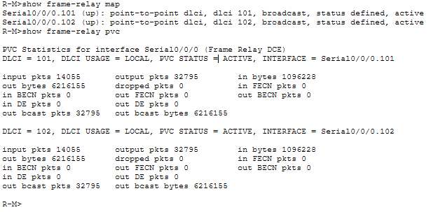
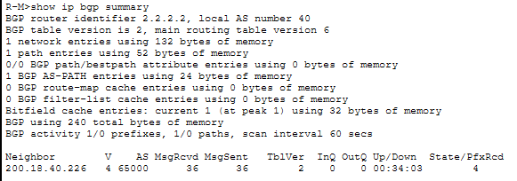

# Configurações por protocolo

[← Voltar ao README](../../README.md) · [English](../en/configuration.md)

Trechos extraídos das running-configs em [`configs/`](../../configs/).

---

## 1. VLANs e roteamento entre VLANs

| VLAN | Nome | Sites |
|---|---|---|
| 10 | Usuários | Matriz, Filial 1, Filial 2 |
| 20 | TI | Matriz, Filial 1, Filial 2 |
| 30 | Serviços / Web | Matriz |
| 99 | Gerência (nativa) | Matriz, Filial 1, Filial 2 |

As portas dos PCs ficam em `switchport mode access` na VLAN correspondente. As ligações entre switches e entre o switch central e o roteador são trunks 802.1Q, com a VLAN 99 como nativa:

```
interface GigabitEthernet0/1
 description **TRUNK p/ R-MATRIZ (Router-on-a-Stick)**
 switchport trunk native vlan 99
 switchport mode trunk
```

O roteamento entre VLANs é feito no roteador de cada site (router-on-a-stick), com uma sub-interface por VLAN. Exemplo do R-M:

```
interface GigabitEthernet0/0.10
 description **Gateway VLAN 10 - Usuarios**
 encapsulation dot1Q 10
 ip address 200.18.40.1 255.255.255.192
 ip helper-address 200.18.40.174
!
interface GigabitEthernet0/0.99
 description **Gateway VLAN 99 - Gerencia**
 encapsulation dot1Q 99 native
 ip address 200.18.40.177 255.255.255.248
```

Cada switch tem uma SVI de gerência na VLAN 99 e o `ip default-gateway` do site.



---

## 2. STP (PVST+)

As prioridades foram ajustadas manualmente para a topologia L2 ficar previsível:

| Switch | Prioridade | Papel |
|---|---|---|
| SW-CORE | 0 (VLAN 99), 24576 (VLANs 10, 20, 30) | Root de todas as VLANs da Matriz |
| SW1-M | 28672 (VLANs 10, 20, 99) | Backup do root |
| SW1-A, SW2-A / SW1-B, SW2-B | 28672 (VLANs 10, 20, 99) | Mesma prioridade nos dois switches de cada filial: o root é decidido pelo menor MAC |

```
spanning-tree mode pvst
spanning-tree vlan 99 priority 0
spanning-tree vlan 10,20,30 priority 24576
```

Nas portas de acesso, `portfast` acelera a subida da porta e `bpduguard` derruba a porta se ela receber BPDU, o que impede que um switch não autorizado se ligue à rede.

```
interface FastEthernet0/23
 switchport access vlan 99
 switchport mode access
 spanning-tree portfast
 spanning-tree bpduguard enable
```



---

## 3. WAN Frame Relay

A Matriz (hub) usa uma sub-interface point-to-point por filial, cada uma com o seu DLCI:

```
interface Serial0/0/0
 encapsulation frame-relay
!
interface Serial0/0/0.101 point-to-point
 description **Link p/ R-A (Filial 1) | DLCI 101**
 ip address 200.18.40.217 255.255.255.252
 frame-relay interface-dlci 101
!
interface Serial0/0/0.102 point-to-point
 description **Link p/ R-B (Filial 2) | DLCI 102**
 ip address 200.18.40.221 255.255.255.252
 frame-relay interface-dlci 102
```

Cada filial tem uma única sub-interface apontando de volta para a Matriz (R-A com DLCI 101, R-B com DLCI 102).



---

## 4. Roteamento interno: OSPF, RIPv2 e redistribuição

| Site | Protocolo |
|---|---|
| Matriz (R-M) | OSPF área 0 + RIPv2 (ponto de redistribuição) |
| Filial 1 (R-A) | OSPF área 0 |
| Filial 2 (R-B) | RIPv2 |

**R-A (Filial 1), só OSPF:**

```
router ospf 1
 router-id 1.1.1.1
 network 200.18.40.64 0.0.0.31 area 0
 network 200.18.40.184 0.0.0.7 area 0
 network 200.18.40.208 0.0.0.7 area 0
 network 200.18.40.216 0.0.0.3 area 0
```

**R-B (Filial 2), só RIPv2.** O `no auto-summary` é necessário com VLSM: sem ele, o RIP resumiria as sub-redes na fronteira classful e perderia as máscaras variáveis.

```
router rip
 version 2
 network 200.18.40.0
 no auto-summary
```

**R-M (Matriz), redistribuição mútua.** As rotas RIP da Filial 2 entram no OSPF (`subnets` para levar as sub-redes, não só as redes classful) e as rotas OSPF entram no RIP com métrica 1:

```
router ospf 1
 router-id 2.2.2.2
 redistribute rip subnets
 network 200.18.40.0 0.0.0.63 area 0
 network 200.18.40.128 0.0.0.31 area 0
 network 200.18.40.160 0.0.0.15 area 0
 network 200.18.40.176 0.0.0.7 area 0
 network 200.18.40.216 0.0.0.3 area 0
!
router rip
 version 2
 redistribute ospf 1 metric 1
 network 200.18.40.0
 no auto-summary
```


---

## 5. BGP com o provedor

A TechEdu opera no **AS 40** e fecha eBGP com o ISP (**AS 65000**), anunciando o bloco agregado `200.18.40.0/24`. A rota estática para `Null0` garante que o /24 exista na tabela de rotas, condição para o BGP anunciá-lo com o comando `network`:

```
router bgp 40
 bgp router-id 2.2.2.2
 neighbor 200.18.40.226 remote-as 65000
 neighbor 200.18.40.226 next-hop-self
 network 200.18.40.0
!
ip route 200.18.40.0 255.255.255.0 Null0
```

Do lado do ISP:

```
router bgp 65000
 bgp router-id 3.3.3.3
 neighbor 200.18.40.225 remote-as 40
```



---

## 6. Serviços: DHCP, DNS e Web

- **DNS e Web** rodam no servidor da VLAN 30 da Matriz, com IP estático `200.18.40.174`. O DNS tem um registro A `web.techedu.local → 200.18.40.174`, e a página `index.html` foi editada para ser identificada nos testes.
- **DHCP:** os roteadores repassam as requisições dos clientes com `ip helper-address` para um servidor em cada site:

| Roteador | VLANs | `ip helper-address` |
|---|---|---|
| R-M | 10, 20, 99 | 200.18.40.174 |
| R-A | 10, 20, 99 | 200.18.40.214 |
| R-B | 10, 20, 99 | 200.18.40.206 |


---

## 7. Hardening

- Hostnames padronizados (`R-M`, `R-A`, `R-B`, `SW-CORE`, `SW1-M`…) e `description` nas interfaces.
- `banner motd` de acesso restrito em todos os equipamentos.
- Senhas de console (`line con 0`), VTY (`line vty 0 15`) e `enable secret` definidas **por site**: uma para os equipamentos da Matriz, uma para os da Filial 1 e uma para os da Filial 2. Os valores foram removidos das configs publicadas.
- `bpduguard` nas portas de acesso.

**Limitações:** `no service password-encryption` (as senhas de linha ficam em texto claro na config) e acesso remoto por Telnet com senha simples, sem SSH.
