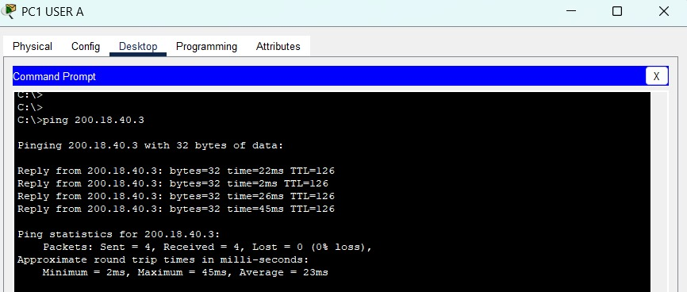
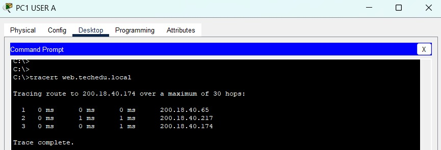
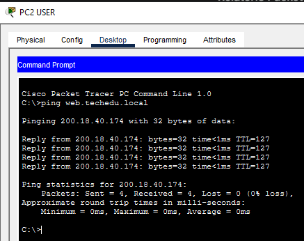
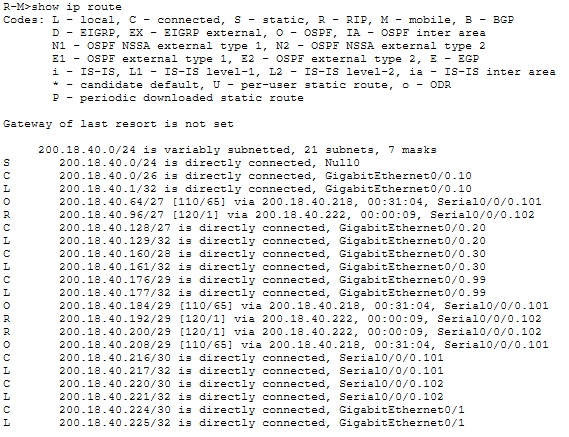
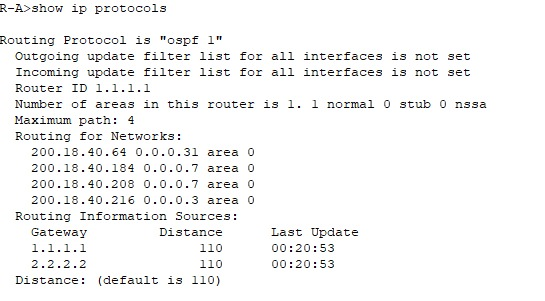
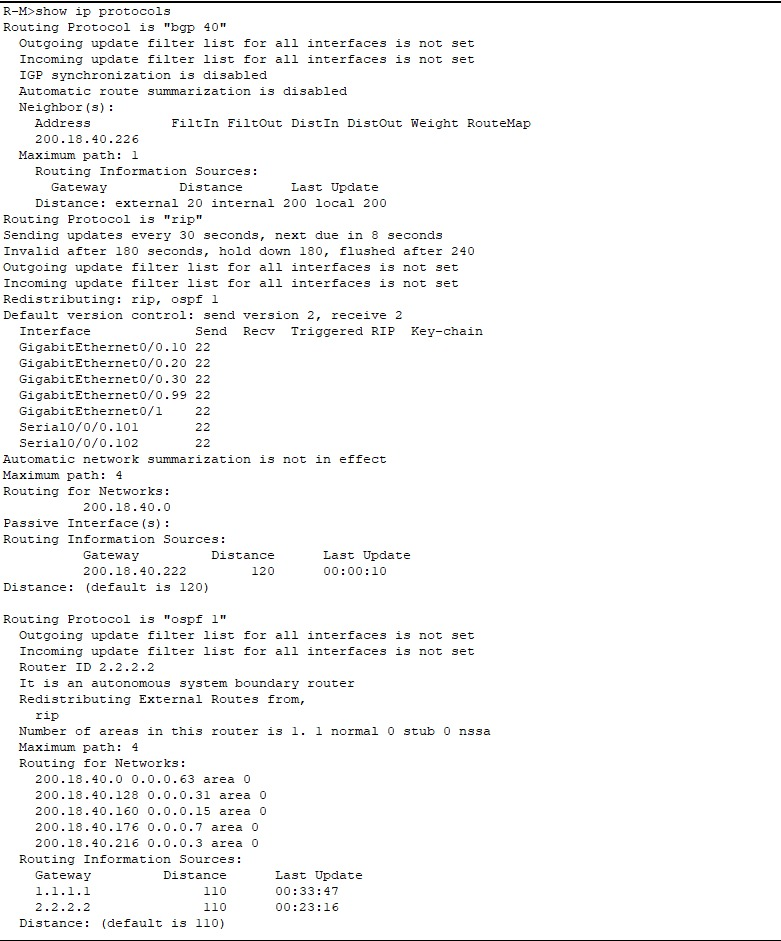
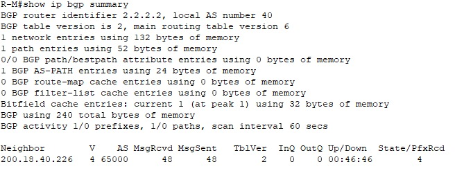
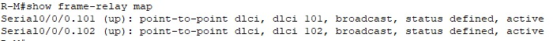

# Validação

[← Voltar ao README](../../README.md) · [English](../en/validation.md)

Os testes foram feitos em sequência, da camada 2 à camada 7.

## 1. Conectividade entre sites

### Ping da Filial 1 para a Matriz

O PC1 da Filial 1 (rede OSPF) faz ping em `200.18.40.3`, um PC da VLAN 10 da Matriz: 4 pacotes enviados e 4 recebidos.

### Traceroute até o servidor web

`tracert web.techedu.local` a partir do PC1 da Filial 1. O nome resolve para `200.18.40.174`, e o caminho passa pelo gateway da Filial 1 (`200.18.40.65`), atravessa o link Frame Relay até o R-M (`200.18.40.217`) e chega ao servidor:

### DNS

Ping por nome em `web.techedu.local`, resolvido pelo DNS da Matriz para `200.18.40.174`:

## 2. Roteamento

### Tabela de rotas do R-M

O R-M aprende as redes da Filial 1 por OSPF (`O`, via `200.18.40.218`) e as da Filial 2 por RIP (`R`, via `200.18.40.222`). Também aparece a rota estática para `Null0` do agregado /24 usado pelo BGP.

### `show ip protocols`

**R-A:** OSPF processo 1, router-id `1.1.1.1`, com as redes da Filial 1 e do link WAN na área 0. As fontes de informação de rota são `1.1.1.1` e `2.2.2.2` (R-M).

**R-M:** OSPF, RIP e BGP ativos ao mesmo tempo, com a redistribuição entre OSPF e RIP.

## 3. BGP

`show ip bgp summary` no R-M: router-id `2.2.2.2`, AS local 40, vizinho `200.18.40.226` no AS 65000 com a sessão estabelecida.

## 4. Frame Relay

`show frame-relay map` no R-M: os dois PVCs, DLCI 101 e DLCI 102, aparecem como `active` nas sub-interfaces point-to-point.

